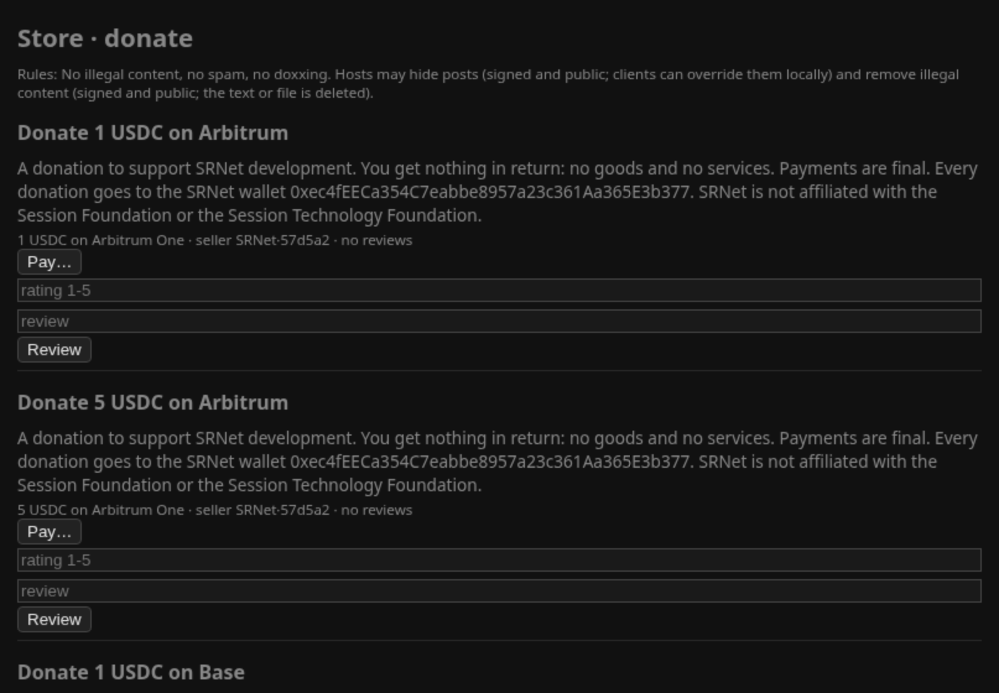
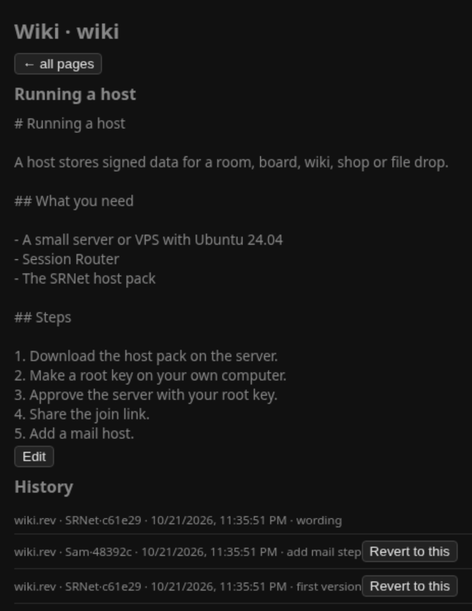

# SRNet host pack

<table>
<tr><td align="center"><br>Store</td><td align="center"><br>File drop</td></tr>
<tr><td align="center"><br>Wiki</td><td align="center"><br>Directory</td></tr>
</table>

**What's new**

- No developer fee anywhere in SRNet.
- Simpler store payments: buyers pay the seller's own address straight from their own wallet. No
  balance, no contract and no escrow.
- Exits now have their own repository,
  [SRNet-VPSHost-ExitPack](https://github.com/SRNet-lab/SRNet-VPSHost-ExitPack).

Full history: [CHANGELOG.md](CHANGELOG.md)

Run your own SRNet host on a server: a **message board, store, wiki, chat rooms, file drop,
profile directory, community directory or mail host**. People use it from the SRNet app. Your
server only stores and serves signed data.

This is beta software.

SRNet is an independent project. It is not affiliated with or endorsed by the Session Foundation
or the Session Technology Foundation.

## Before you start

You need two machines:

- **A server** for the host (Debian or Ubuntu with Python 3.10 or newer; Ubuntu 24.04 x86_64 for
  the Session Router step).
- **Your own computer** (a laptop or desktop, not the server). It keeps your **root key**, the
  master key that proves the host is yours. Keeping it off the server means someone who breaks
  into the server can't take over your host. You use it to approve the server now and again
  every 90 days.

## Set up a chat room host

Each step says where it runs. The full guide, with every host type and option, is
[docs/HOST-GUIDE.md](docs/HOST-GUIDE.md).

**1. On the server: download the pack.**

```sh
cd ~
sudo apt update
sudo apt install -y git curl python3 python3-cryptography
git clone https://github.com/SRNet-lab/SRNet-TypedSNApp-HostPack.git
cd SRNet-TypedSNApp-HostPack
```

**2. On your computer: download the pack and make your root key.**

```sh
cd ~
sudo apt install -y git python3 python3-cryptography
git clone https://github.com/SRNet-lab/SRNet-TypedSNApp-HostPack.git
cd SRNet-TypedSNApp-HostPack
./bin/srnet-host root init
```

Back up `srnet-root/root.key` (a USB stick, or a paper copy).

**3. On the server: create the host.**

```sh
sudo ./bin/srnet-host init --type rooms --name lobby --sesh new
```

It prints the server's host key and writes `/opt/srnet-host/lobby/request.json`.

**4. On your computer: approve the server.**

```sh
scp you@your-server:/opt/srnet-host/lobby/request.json .
./bin/srnet-host root sign request.json --days 90
scp delegation.json you@your-server:SRNet-TypedSNApp-HostPack/
```

Before you answer `y`, check that the host key it shows is the one from step 3.

**5. On the server: start the host.**

```sh
sudo ./bin/srnet-host install-delegation delegation.json --prefix /opt/srnet-host/lobby
```

**6. On the server: install Session Router**, the same SRNet build the SRNet app uses
([Session-Router-SRNet](https://github.com/SRNet-lab/Session-Router-SRNet)):

```sh
cd /tmp
curl -fLO https://github.com/SRNet-lab/Session-Router-SRNet/releases/download/v1.1.0-srnet6/session-router-srnet_1.1.0+srnet6_amd64.deb
echo "5c1c9b553b25649657f9f8e3ae0431aa3fe0534c82e65214588c728307bf3237  session-router-srnet_1.1.0+srnet6_amd64.deb" | sha256sum -c \
  && sudo apt install -y ./session-router-srnet_1.1.0+srnet6_amd64.deb \
  && sudo apt-mark hold session-router-srnet
cd ~/SRNet-TypedSNApp-HostPack
```

You should see `OK` after the file name before apt starts.

**7. On the server: give the host its `.sesh` address and open the firewall.**

```sh
sudo ./bin/srnet-host front --sesh-import /opt/srnet-host/lobby/sesh/identity.key \
    --host /opt/srnet-host/lobby
sudo ufw allow in on sr-front to any port 80 proto tcp
```

The address answers within a minute or two. The server does not need the SRNet app.

**8. Share your invite link.**

```sh
./bin/srnet-host link --prefix /opt/srnet-host/lobby
```

People paste the link on Home in the SRNet app.

Every 90 days, run `sudo ./bin/srnet-host renew --prefix /opt/srnet-host/lobby` on the server
and repeat steps 4 and 5. `sudo ./bin/srnet-host status --prefix /opt/srnet-host/lobby` tells you
when renewal is due.

## Other host types

Use another `--type` in step 3: `board`, `store`, `wiki`, `rooms` (`--room` adds more rooms),
`files`, `people`, `directory` or `mail`. Several hosts can share one `.sesh` address. See
[docs/HOST-GUIDE.md](docs/HOST-GUIDE.md).

Hosting a file drop makes you a Storage Seller. The SRNet app encrypts files on the uploader's
computer before upload, unless the uploader chooses to publish a file unencrypted, so with
encryption on you store only ciphertext. Mail is sealed the same way on the sender's computer,
so a mail host can't read the mail it holds.

**Coming soon:** Storage Sellers will be able to turn off public hosting, so they hold only
encrypted files they can't read.

A mail host is open to new inboxes by default (up to 1000). Close sign-up any time with
`sudo ./bin/srnet-host mail --prefix <dir> --closed`.

## Contents

| Path | What |
|---|---|
| `bin/srnet-host` | installer and admin tool |
| `mbfmt/ mbhost/ typed/ mbclient/` | host code (and a minimal client used by `scripts/demo.py`) |
| `docs/HOST-GUIDE.md` | step-by-step guide |
| `docs/Typed-SNApps-Walkthrough.pdf` | an illustrated tour of the client, ending with how to run a host |
| `docs/LICENSES.md` | licence notes |
| `tests/` | automated tests |
| `RELEASING.md` | how maintainers build and sign releases |

## Related repositories

- [SRNet-Desktop](https://github.com/SRNet-lab/SRNet-Desktop): the SRNet client people use to
  join your host, read and post, and send mail.
- [Session-Router-SRNet](https://github.com/SRNet-lab/Session-Router-SRNet): the Session Router
  build the client runs, with exit mapping added.
- [SRNet-VPSHost-ExitPack](https://github.com/SRNet-lab/SRNet-VPSHost-ExitPack): run a paid
  exit on an Ubuntu server.

## License

MIT. See [LICENSE](LICENSE) and [docs/LICENSES.md](docs/LICENSES.md).

## Donations

If SRNet is useful to you, donations are welcome at
`0xec4fEECa354C7eabbe8957a23c361Aa365E3b377` (USDC or ETH on Arbitrum One or Base).
